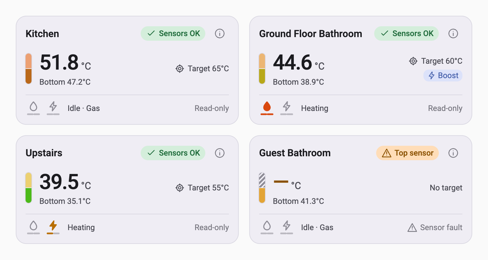
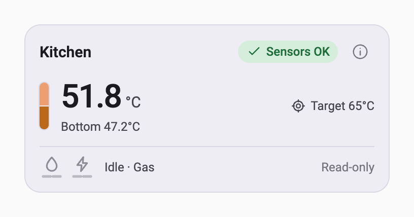
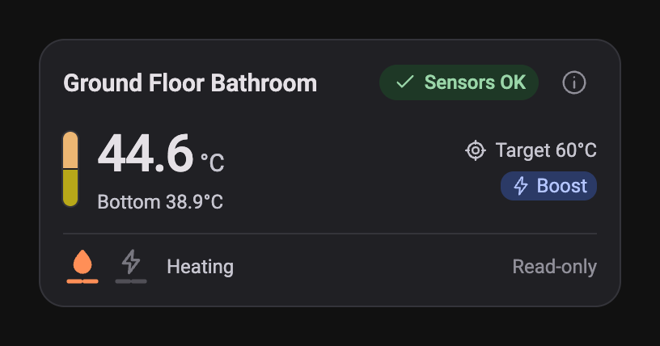
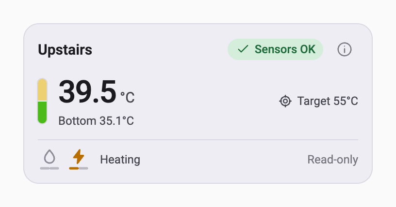
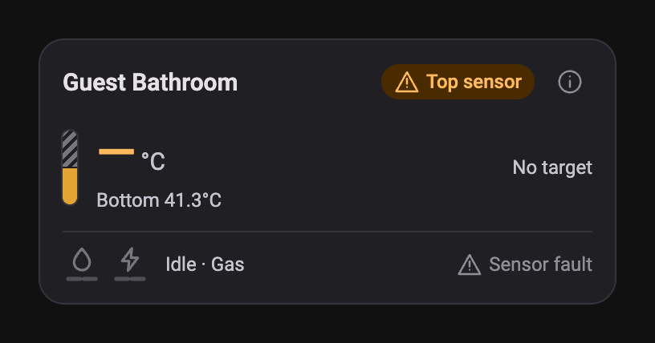
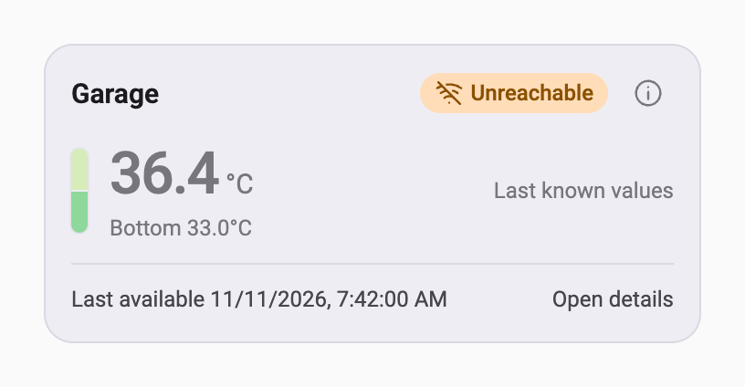
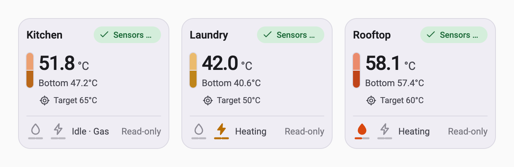

# ezGeyser Direct for Home Assistant

A Home Assistant custom integration that reads **ezGeyser** water heaters **directly over your local network**. It
finds geysers on its own, adds each one as a device with the name you give it, and shows its temperatures and heating
status. It only reads: it never changes anything on the geyser, and it never talks to the vendor's cloud.

> **Not affiliated with ezGeyser.** This is an independent project with no association with
> [ezGeyser](https://ezgeyser.com/) or its makers, and it is not endorsed or supported by them. It exists because the
> geyser serves a local web interface backed by a clear, JSON-based HTTP API, and this integration reads that same API.
> It has been tested against responses captured from one geyser (Hybrid v2, firmware 1.4.0), and every value it shows
> is what the geyser reports. **None of the values is a safety signal.**

<picture>
  <source media="(prefers-color-scheme: dark)" srcset="assets/screenshots/dashboard-dark.png">
  
</picture>

<sub>The bundled dashboard card, with simulated readings. More in [Screenshots](#screenshots).</sub>

## Install

Requires Home Assistant 2026.10 or newer. ezGeyser Direct is not in the Marketplace's community catalog yet, so you
add it from its GitHub link once. After that it installs and updates like any other Marketplace item.

### One click

[](https://my.home-assistant.io/redirect/hacs_repository/?owner=basghar&repository=home-assistant-ezgeyser&category=integration)

The button opens the repository page in your own Home Assistant (Marketplace on 2026.11, HACS on 2026.10). Confirm
**Add custom repository**, then continue from step 4 below.

### Marketplace, step by step (Home Assistant 2026.11+)

1. In Home Assistant, open **Settings > Marketplace**. The first time, read the warning, select **I understand the
   risks and agree**, then **Continue**.
2. Open the **Add from link** tab.
3. In **Add from a GitHub link**, enter `https://github.com/basghar/home-assistant-ezgeyser` as the **GitHub link**,
   choose **Integration** as the **Type** if asked, and select **Add**. If Home Assistant asks you to **Connect
   GitHub**, do so and add the link again.
4. On the **ezGeyser Direct** page, select **Install**, check the version, and confirm.
5. Select **Restart Home Assistant** when prompted, then refresh your browser.
6. After the restart, select **Set up** on the same page, or follow [Add a geyser](#add-a-geyser).

**Updates** show in **Settings > Marketplace > Updates**. Install the update, restart Home Assistant, and refresh
your browser so the dashboard card loads its new version.

**Uninstall:** open **ezGeyser Direct** in **Settings > Marketplace > Installed**, select **Uninstall**, and restart.
Home Assistant warns you first if this also deletes your geysers' devices and entities.

### HACS (Home Assistant 2026.10)

Marketplace replaces HACS in Home Assistant 2026.11. On 2026.10, open **HACS > ⋮ > Custom repositories**, add the
same URL with type **Integration**, download **ezGeyser Direct**, and restart.

### Manual

Copy `custom_components/ezgeyser/` into your Home Assistant `config/custom_components/` folder and restart. You
update by copying it again.

## Add a geyser

You name the geyser in every case. The name becomes the device name and the start of every entity ID.

- **Discovered automatically.** After the restart, a **Discovered: ezGeyser** card appears under **Settings > Devices &
  services** for each geyser on your network. Select **Add**, type a name such as `Kitchen`, and submit. Home Assistant
  finds geysers when they get their address from your router (DHCP, the geyser calls itself `ezgeyser-…`) or when they
  announce themselves on the network (mDNS).
- **Scan.** **Settings > Devices & services > Add integration > ezGeyser Direct**. Leave the address empty and submit:
  the integration looks for geysers on your network for up to 8 seconds and lists the ones not added yet. Pick one and
  name it.
- **By address.** In the same dialog, type the geyser's IP address, for example `192.168.1.50`.

Give each geyser a fixed address in your router (a DHCP reservation). If its address does change, discovery updates it
on its own; you can also change it with **Reconfigure** on the integration's entry. The integration recognises a geyser
by its MAC address, so it refuses to switch an entry over to a different geyser.

## Entities

For a geyser named **Kitchen**:

| Entity ID | Shows |
|---|---|
| `sensor.kitchen_temperature_top` | Top tank sensor, °C. Unknown while the sensor reports a fault. |
| `binary_sensor.kitchen_temperature_top_ok` | **OK** / **Fault**: whether the top sensor reading is valid. |
| `sensor.kitchen_temperature_bottom` | Bottom tank sensor, °C. Unknown while the sensor reports a fault. |
| `binary_sensor.kitchen_temperature_bottom_ok` | **OK** / **Fault**: whether the bottom sensor reading is valid. |
| `sensor.kitchen_temperature_target` | Target temperature of the running timer or preset, °C. 0 most likely means no target. |
| `binary_sensor.kitchen_heating_burner_1` | **Flame** / **No flame**: flame sensor 1, at one end of the burner. |
| `binary_sensor.kitchen_heating_burner_2` | **Flame** / **No flame**: flame sensor 2, at the other end of the same burner. |
| `binary_sensor.kitchen_heating_element_1` | **Heating** / **Off**: electric heating element 1. |
| `binary_sensor.kitchen_heating_element_2` | **Heating** / **Off**: electric heating element 2. |
| `sensor.kitchen_heating_source` | **Gas**, **Electric**, **Hybrid** or **Unknown**: the selected heating source. |
| `binary_sensor.kitchen_heating_boost_mode` | **Active** / **Inactive**: boost mode. |

The labels are for display. In automations and templates, binary sensors are `on` (the first label) or `off`, and the
heating source is `gas`, `electric`, `hybrid` or `unknown`. Only the Gas code is confirmed so far; any other code shows
as Unknown, and its raw value is in the `source_code` attribute.

The `temperature_` and `heating_` parts group the entities by kind. If you rename the device later (**Settings >
Devices**), Home Assistant offers to rename its entity IDs to match.

So far only idle values have been captured, so what each flag shows while the geyser is heating has not been checked.
Never use a burner flag as proof that a flame is, or is not, burning.

## Screenshots

These show the real bundled card, but with **simulated readings**: the geysers and values are made up. Only idle
values have been captured from a real geyser so far, so the heating screenshots show how the card displays those
flags, not a confirmed heating cycle.

| | |
|---|---|
|  |  |
| **Idle.** Top reading large, bottom below it, the target on the right, and the selected source in the footer. | **Heating on gas, dark theme.** Both burner sides report flame, and Boost is active. |
|  |  |
| **Heating on an electric element.** The bolt lights, and the bar shows which of the two elements is on. | **Sensor fault, dark theme.** The faulty reading shows a dash, and the badge names the sensor. |
|  | |
| **Unreachable.** Muted last known values and when Home Assistant last had them. | |

In narrow dashboard columns the card switches to a stacked layout:



The images are rendered from [`assets/screenshots/harness.html`](assets/screenshots/harness.html), which loads the
card with simulated Home Assistant data. Run `assets/screenshots/capture.sh` (needs Google Chrome) to regenerate
them after changing the card.

## Geyser overview card

The responsive **ezGeyser overview** custom dashboard card is bundled at
[`custom_components/ezgeyser/www/ezgeyser-card.js`](custom_components/ezgeyser/www/ezgeyser-card.js).
It uses Home Assistant's [standard custom-card API](https://contributors.home-assistant.io/frontend/custom-ui/card/),
with no JavaScript dependencies, external fonts, external network requests or device controls.

### Add the card to an existing dashboard

From version **0.4.2**, the integration serves and registers the bundled card automatically at startup.
No copying files or manually registering a resource is required.

1. Update **ezGeyser Direct** in Marketplace, restart Home Assistant and refresh your browser.
2. Open your dashboard, select **Edit > Add card**, and search for **ezGeyser overview** (community cards).
3. Select your geyser using Home Assistant’s device selector. Optionally set the name, main sensor, element count and theme.
4. Save and place the card. Repeat for other geysers.

The selector stores the Home Assistant `device_id`. The card resolves entities from the entity registry at runtime,
including renamed IDs, and refreshes its mappings when registry entries change.
For manual YAML configuration, a copyable example is in [`dashboards/geyser.yaml`](dashboards/geyser.yaml).
The integration registers a versioned JavaScript module resource and updates it on upgrades. Earlier manually
registered `/local/ezgeyser-card.js` resources are migrated automatically in storage mode; other cards and dashboard
layouts are left intact. You may delete the old copy from `www` after updating.

For user-managed YAML resource lists, the integration uses Home Assistant's frontend module loader instead of
modifying your YAML. Remove any older manual ezGeyser resource from YAML to avoid loading two copies.
Headless installations without `frontend` skip card registration. If the card is missing after an update,
restart Home Assistant, hard-refresh your browser, and check the integration logs for setup errors.

### Appearance and semantics

The card follows Home Assistant light/dark mode, with the Android app's tonal surfaces, health pill, large main
reading, secondary sensor, target, Boost chip and heating footer. The top and bottom halves of its tank bar always
represent the physical top and bottom sensors. Temperature colours interpolate continuously from blue through
teal, amber and orange to red. An additional bounded lightness difference emphasizes relative top/bottom differences
(as small as 1 °C); colours are illustrative rather than a calibrated scale. Numeric values and a descriptive tank
label/tooltip provide the precise readings. Invalid sensors use an amber dash and a grey hatched half.

Both heat-source icons are custom inline SVGs using the specified paths. A lit flame means a reported burner flag is
on; the two bars show the left/right sides of the **same burner**. The bolt and its bars show the elements. Off glyphs
are outlines. Unknown heating flags keep icons dimmed and show “Heating status unknown.” Every icon has an accessible
label. Card click, Enter or Space opens Home Assistant's main temperature entity details/history.

The card wraps by **its own width**, including narrow dashboard columns. It has no fixed height, uses a compact
three-row layout, and supports Home Assistant Sections and Masonry views. The health badge says **Sensors OK** for
valid temperature sensors, names a single sensor fault, or counts both faults. It does not imply other health checks.

Unavailable entities show **Unreachable** and muted last-known readings when this card has seen them during the
current browser session. The displayed “Last available” time is Home Assistant's entity update timestamp, not the
last successful device poll. On a fresh page with no previous readings, values show dashes. Missing entity IDs show
**Check entities**. There is no retry button because the integration already retries and exposes no refresh action.
Wi-Fi, cloud, clock, vacation and timer entities are not currently exposed, so their icons and values are omitted.

### Configuration

From **0.5.0**, select the whole geyser by its Home Assistant device ID. The card discovers its temperature and
heating entities through the entity registry, using stable integration unique IDs. It never constructs entity IDs
from the device name, area or a shared prefix.

```yaml
type: custom:ezgeyser-card
device_id: YOUR_HOME_ASSISTANT_DEVICE_ID
name: Ground Floor Bathroom
```

Use the visual device selector to avoid typing the ID. For a YAML dashboard, open the geyser’s device page under
**Settings > Devices & services > Devices** and copy the ID from `/config/devices/device/<device_id>` in its URL.
This ID belongs to your Home Assistant installation; it is not the device name, IP address, MAC address or an
entity ID. Removing the device and adding it again may require selecting it again.

`name` is optional and defaults to the HA device name. `main: bottom` swaps the large and secondary readings; it does
**not** swap the physical tank halves. `element_count: 1` renders a single solid element bar (either reported element
flag lights it); the default is two. The card never infers installed hardware from an element remaining off.
`theme: auto` follows HA; `light` or `dark` forces a palette. Temperatures use HA's display units; colour calculations
and zero-target detection convert back to Celsius. Source code 1 is Gas; other codes display as `Source N?`.

The card listens for entity registry updates, so renaming an individual sensor does not require editing the card.
It shows **Loading entities**, **Registry unavailable**, or **Check entities** when it cannot resolve the selected
device’s entities; it does not open a misleading more-info dialog for a missing entity.

Older `entity:` configurations remain supported: the card looks up that exact entity in the registry and finds its
related entities by device membership. Renaming that anchor still requires updating the legacy `entity:` value, so
migrating to `device_id:` is recommended. Explicit legacy `entities:` mappings also remain supported in YAML. Remove
`entity:` and `entities:` when switching to the standard visual device selector.

You can also use Home Assistant's built-in **Entities card** to show individual flags and their history.

## How it reads the geyser

- Every geyser is read **once a second**, the same rate as the geyser's own web page. Only one request is in flight at
  a time across all your geysers, because the geyser has very little memory. Each request has a 3-second timeout.
- If a geyser misses two reads, its last values stay. On the third miss its entities show **unavailable**, and the
  integration waits 2, 2, 4, 8, 15, then 30 seconds between tries until it answers again.
- The status response does not say which geyser sent it, so every 5 minutes the integration also checks that the MAC
  address at that IP is still the geyser you added. If another device answers there, the entities stop updating until
  the address is fixed.
- The scan asks only devices that announced themselves on the network, one at a time, at most 8 per scan. It never
  tries every address in your network.

## Safety

The geyser's local web interface has no password: any device on your network can use it. This integration is built so
that it cannot be turned against the geyser:

- It sends only three read-only requests, `GET /quickStatus`, `GET /data` and `GET /cloudStatus`. A guard
  (`custom_components/ezgeyser/guard.py`) refuses any other path, any other method, any query string, and any address
  outside your local network before a request is sent.
- It has no switches, buttons, numbers or other controls, and no services that change anything.
- It never asks for or stores the geyser's Wi-Fi settings.

## Troubleshooting

- **No discovery card:** use **Add integration** and the scan, or type the address. Discovery by DHCP needs Home
  Assistant to see your network's DHCP traffic (Home Assistant OS does); mDNS needs the geyser and Home Assistant on the
  same network segment.
- **"The geyser does not answer":** check that the geyser's web page opens at `http://<address>/` from a computer on
  the same network.
- **Debug logs:** add this to `configuration.yaml` and restart:

  ```yaml
  logger:
    logs:
      custom_components.ezgeyser: debug
  ```

## Development

The tests use `pytest-homeassistant-custom-component` 0.13.375 (Home Assistant 2026.10.4) on Python 3.14:

```sh
python3.14 -m venv .venv && .venv/bin/pip install pytest-homeassistant-custom-component==0.13.375 zeroconf ruff mypy
.venv/bin/ruff check . && .venv/bin/ruff format --check . && .venv/bin/mypy && .venv/bin/pytest -q
```

The **Validate** workflow runs the same checks on every push, plus Home Assistant's `hassfest` and the HACS validation.

## License

[MIT](LICENSE).
