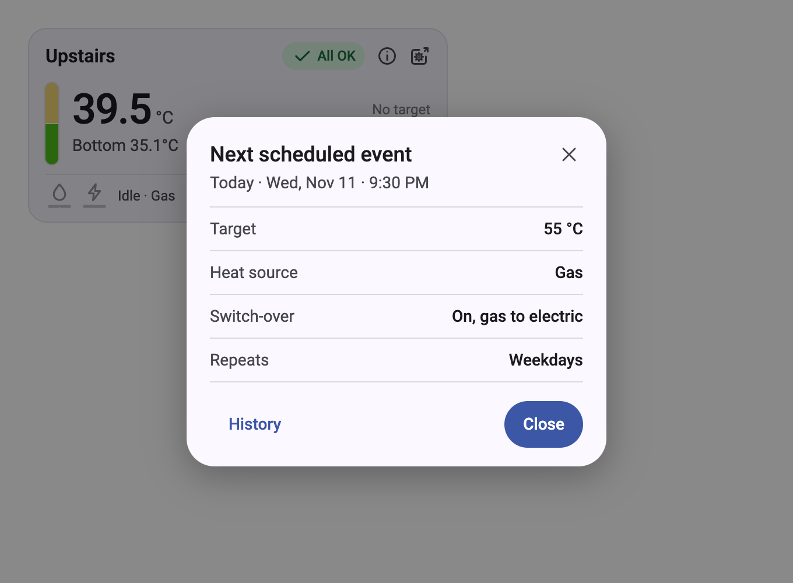

# ezGeyser Direct for Home Assistant

A Home Assistant custom integration that reads **ezGeyser** water heaters **directly over your local network**. It
finds geysers on its own, adds each one as a device with the name you give it, and shows its temperatures and heating
status. It only reads: it never changes anything on the geyser, and it never talks to the vendor's cloud.

> **Not affiliated with ezGeyser.** This is an independent project with no association with
> [ezGeyser](https://ezgeyser.com/) or its makers, and it is not endorsed or supported by them. It exists because the
> geyser serves a local web interface backed by a clear, JSON-based HTTP API, and this integration reads that same API.
> It has been tested against responses captured from one geyser (Hybrid v2, firmware 1.4.0), and every value it shows
> is what the geyser reports. **None of the values is a safety signal.**

<picture>
  <source media="(prefers-color-scheme: dark)" srcset="assets/screenshots/dashboard-dark.png">
  
</picture>

<sub>The bundled dashboard card, with simulated readings. More in [Screenshots](#screenshots).</sub>

## Install

Requires Home Assistant 2026.10 or newer. ezGeyser Direct is not in the Marketplace's community catalog yet, so you
add it from its GitHub link once. After that it installs and updates like any other Marketplace item.

### One click

[](https://my.home-assistant.io/redirect/hacs_repository/?owner=basghar&repository=home-assistant-ezgeyser&category=integration)

The button opens the repository page in your own Home Assistant (Marketplace on 2026.11, HACS on 2026.10). Confirm
**Add custom repository**, then continue from step 4 below.

### Marketplace, step by step (Home Assistant 2026.11+)

1. In Home Assistant, open **Settings > Marketplace**. The first time, read the warning, select **I understand the
   risks and agree**, then **Continue**.
2. Open the **Add from link** tab.
3. In **Add from a GitHub link**, enter `https://github.com/basghar/home-assistant-ezgeyser` as the **GitHub link**,
   choose **Integration** as the **Type** if asked, and select **Add**. If Home Assistant asks you to **Connect
   GitHub**, do so and add the link again.
4. On the **ezGeyser Direct** page, select **Install**, check the version, and confirm.
5. Select **Restart Home Assistant** when prompted, then refresh your browser.
6. After the restart, select **Set up** on the same page, or follow [Add a geyser](#add-a-geyser).

**Updates** show in **Settings > Marketplace > Updates**. Install the update, restart Home Assistant, and refresh
your browser so the dashboard card loads its new version.

**Uninstall:** open **ezGeyser Direct** in **Settings > Marketplace > Installed**, select **Uninstall**, and restart.
Home Assistant warns you first if this also deletes your geysers' devices and entities.

### HACS (Home Assistant 2026.10)

Marketplace replaces HACS in Home Assistant 2026.11. On 2026.10, open **HACS > ⋮ > Custom repositories**, add the
same URL with type **Integration**, download **ezGeyser Direct**, and restart.

### Manual

Copy `custom_components/ezgeyser/` into your Home Assistant `config/custom_components/` folder and restart. You
update by copying it again.

## Add a geyser

You name the geyser in every case. The name becomes the device name and the start of every entity ID.

- **Discovered automatically.** After the restart, a **Discovered: ezGeyser** card appears under **Settings > Devices &
  services** for each geyser on your network. Select **Add**, type a name such as `Kitchen`, and submit. Home Assistant
  finds geysers when they get their address from your router (DHCP, the geyser calls itself `ezgeyser-…`) or when they
  announce themselves on the network (mDNS).
- **Scan.** **Settings > Devices & services > Add integration > ezGeyser Direct**. Leave the address empty and submit:
  the integration looks for geysers on your network for up to 8 seconds and lists the ones not added yet. Pick one and
  name it.
- **By address.** In the same dialog, type the geyser's IP address, for example `192.168.1.50`.

Give each geyser a fixed address in your router (a DHCP reservation). If its address does change, discovery updates it
on its own; you can also change it with **Reconfigure** on the integration's entry. The integration recognises a geyser
by its MAC address, so it refuses to switch an entry over to a different geyser.

## Entities

For a geyser named **Kitchen**:

| Entity ID | Shows |
|---|---|
| `sensor.kitchen_temperature_top` | Top sensor, °C, [smoothed](#smoothed-temperatures). Unknown while the sensor reports a fault. |
| `binary_sensor.kitchen_temperature_top_ok` | **OK** / **Fault**: whether the top sensor reading is valid. |
| `sensor.kitchen_temperature_bottom` | Bottom sensor, °C, [smoothed](#smoothed-temperatures). Unknown while the sensor reports a fault. |
| `binary_sensor.kitchen_temperature_bottom_ok` | **OK** / **Fault**: whether the bottom sensor reading is valid. |
| `sensor.kitchen_temperature_target` | The target the geyser is heating to, °C: from a running timer, the current schedule entry, or 0. 0 means no heating. |
| `binary_sensor.kitchen_burner_left_flame_sensor` | **Flame** / **No flame**: flame input 1 (`burner1Status`). |
| `binary_sensor.kitchen_burner_right_flame_sensor` | **Flame** / **No flame**: flame input 2 (`burner2Status`). |
| `binary_sensor.kitchen_heating_element_1` | **Heating** / **Off**: electric heating element 1, as commanded. |
| `binary_sensor.kitchen_heating_element_2` | **Heating** / **Off**: electric heating element 2, as commanded. |
| `sensor.kitchen_heating_source` | **Gas**, **Electric**, **Hybrid** or **Unknown**: the source in use; switch-over can temporarily replace the one you chose. |
| `binary_sensor.kitchen_heating_boost_mode` | **Active** / **Inactive**: boost mode. |
| `binary_sensor.kitchen_heating_vacation_mode` | **Active** / **Inactive**: vacation mode. |
| `sensor.kitchen_timer_remaining` | Whole minutes left on the running timer (at least 1 while any time is left), shown without a unit. 0 when no timer runs. |
| `sensor.kitchen_next_scheduled_event` | When the next enabled schedule starts: see [Next scheduled event](#next-scheduled-event). |
| `sensor.kitchen_network_wi_fi_signal` | **Excellent** (−50 dBm or stronger), **Good** (to −60), **Fair** (to −70) or **Weak**. |
| `binary_sensor.kitchen_network_cloud_connection` | **Connected** / **Disconnected**: the geyser's link to the ezGeyser cloud, which the official app uses. |
| `binary_sensor.kitchen_device_clock` | **Problem** / **OK**: whether the geyser's clock is off; see [Next scheduled event](#next-scheduled-event). |
| `sensor.kitchen_temperature_top_raw` | Disabled by default. The top sensor's reading every second, unsmoothed. |
| `sensor.kitchen_temperature_bottom_raw` | Disabled by default. The bottom sensor's reading every second, unsmoothed. |
| `sensor.kitchen_network_wi_fi_rssi` | Disabled by default. The Wi-Fi signal rounded to 5 dBm steps; see [Wi-Fi history](#wi-fi-history). |

The labels are for display. In automations and templates, binary sensors are `on` (the first label) or `off`, the
heating source is `gas`, `electric`, `hybrid` or `unknown`, and the Wi-Fi signal is `excellent`, `good`, `fair` or
`weak`. The geyser codes Gas as 1, Electric as 2 and Hybrid as 3, but this version names only code 1: any other code
shows as Unknown, and its raw value is in the `source_code` attribute.

The `temperature_`, `heating_`, `timer_`, `network_` and `device_` parts group the entities by kind. If you rename the
device later (**Settings > Devices**), Home Assistant offers to rename its entity IDs to match.

**Top** and **bottom** are the geyser's own names for its two sensors; which probe sits where in the tank is not
established. The geyser heats on the **bottom** sensor: it starts below the target, stops at the target, and after a
stop starts again only once bottom is 5 °C below it. The top sensor can only stop heating early, at target + 5 °C. If
the bottom sensor reports a fault, the geyser does not heat.

The element flags show what the geyser switched on, not measured current, and a flame flag only means its sensor
input crossed a threshold. Never use a burner flag as proof that a flame is, or is not, burning.

## Screenshots

The real card with **simulated readings**; the geysers and values are made up.

| | |
|---|---|
|  |  |
| **Idle** | **Heating on gas**, dark theme |
|  |  |
| **Heating on the elements** | **Three issues**, dark theme |
|  |  |
| **Unreachable** | **Next event details** |

Cards narrower than about 295 px stack their readings, as in the Android app, so cards side by side stay the same
height:


To regenerate them, run `assets/screenshots/capture.sh` (needs Google Chrome).

## Geyser overview card

The integration includes the **ezGeyser overview** dashboard card
([`ezgeyser-card.js`](custom_components/ezgeyser/www/ezgeyser-card.js)) and registers it on its own: there are no
files to copy and no resources to add. It has no dependencies and makes no network requests of its own.

### Add the card to a dashboard

1. Open your dashboard, select **Edit > Add card**, and search for **ezGeyser overview**.
2. Pick your geyser under **Geyser**. Optionally set the name, main temperature, number of electric elements, theme,
   and whether schedule details show the heat source and switch-over.
3. Save. Add one card per geyser.

If the card is not in the list, restart Home Assistant, hard-refresh your browser, and check the logs for ezGeyser
setup errors. Installations without Home Assistant's `frontend` skip the card.

### Reading the card

- **Tank bar:** the top half is the top sensor and the bottom half the bottom sensor. The colour runs from blue (cool)
  through amber to red (hot), with extra lightness contrast so that even a 1 °C difference shows. The colours are a
  guide; the numbers are the reading. A grey hatched half and an amber dash mean that sensor reports a fault.
- **Badge:** **All OK**, the one problem by name (**Top sensor**, **Bottom sensor**, **Weak Wi-Fi**, **Cloud
  offline** or **Clock off**), or how many there are, such as **3 issues**; its tooltip lists them.
- **Right column:** the target beside a thermometer, or **Target not set** (target 0) or **Target unknown**; then the
  next scheduled event: its time, **+1** when it is tomorrow (**+2** and so on), and the temperature it sets, or
  **Off**. Select it for its [details](#next-scheduled-event). **Boost** and **Vacation** appear as pills while on.
- **Footer:** the status chip starts with the flame for the burner, whose two bars are its two sides, and the bolt for
  the electric elements, one bar each. A filled icon means the flag is on, an outline means off, and
  dimmed means unknown. After a divider it says **Heating** when both flame sensors or either electric element
  report on, **Flame detected** when only one flame sensor reports on and both elements are off, or **Idle** when all
  four flags are off; then the time left while a timer runs. The individual flame bars still show each sensor. The chip
  is outlined while idle or showing **Flame detected**, and tinted in the gas or electric colour while heating
  (gas when both flame sensors report on, electric when an element is on with only one flame sensor). These labels do
  not establish valve position or the cause of a flame indication. While the heating
  status is unknown it holds only the dimmed icons, and a running timer follows it. The **Mode** pill shows flame and
  bolt icons for gas only, electric only, or both with an arrow for hybrid, and reads **Unknown** for any other source;
  select it for source details. On the right are the Wi-Fi icon, whose lit arcs show the level (unlit arcs stay visible,
  muted), the cloud link and, only while it is off, the device clock; amber marks a problem.
- **Unreachable:** the last values this browser saw, muted, with the time Home Assistant last updated them. That is
  not necessarily the last successful read. A freshly opened page has no last values and shows dashes.
- **Loading entities**, **Registry unavailable** or **Check entities:** the card cannot find the selected geyser's
  entities.
- **Selecting** the flame icon or its bars opens Home Assistant's History page with both flame sensors selected.
  The electrical icon and its bars open history for one or both elements, according to **Electric elements**.
  Both show the last six hours ending at the time you click. A reading, tank half, pill or footer item opens that
  entity's details and history. ⓘ opens the main temperature. The box-and-gear action beside it opens the geyser's
  local web page in a new browser tab; its tooltip shows the address. Both action drawings sit just inside the badge's
  height, scale their widths proportionally, and sit 10 px apart. The browser action is dimmed and disabled while
  unreachable or while its address is unavailable. Your browser must be on the geyser's network to reach that page.

Cards are all the same height, follow Home Assistant's light or dark mode, fit their column, and work in Sections and
Masonry views. Text never shrinks or wraps: when a card is too narrow, the mode pill loses its word and divider, then
the timer's text is left out, then the state text is shortened. Cards narrower than about 260 px put the Wi-Fi and
cloud icons on a second footer line, and narrower than about 185 px the mode pill too. Select the Wi-Fi icon for the
level and its history. A missing or disabled entity just hides its item.

### YAML configuration

```yaml
type: custom:ezgeyser-card
device_id: YOUR_HOME_ASSISTANT_DEVICE_ID
name: Ground Floor Bathroom
```

| Option | Default | Meaning |
|---|---|---|
| `device_id` | required | The geyser's Home Assistant device ID: open its page under **Settings > Devices & services > Devices** and copy the part after `/config/devices/device/` in the address. It is not the name, IP address, MAC address or an entity ID. If you remove the device and add it again, pick it again. |
| `name` | device name | Title shown on the card. |
| `main` | `top` | Which sensor is the large reading: `top` or `bottom`. The tank halves never swap. |
| `element_count` | `2` | `1` draws a single element bar, lit when either element flag is on. The card never guesses which elements are installed. |
| `theme` | `auto` | `auto` follows Home Assistant; `light` or `dark` forces a palette. |
| `show_heat_source` | `true` | `false` hides **Heat source** and **Switch-over** in the schedule details, for a gas-only or electric-only geyser. |

The card finds the geyser's entities by device, so renaming the device or any entity never breaks it. The same
example is in [`dashboards/geyser.yaml`](dashboards/geyser.yaml).

### Upgrading from versions before 0.5.0

- **Card added by hand (before 0.4.2):** a manually added `/local/ezgeyser-card.js` resource is replaced
  automatically on dashboards managed in the UI; afterwards you can delete the old file from `www`. If your resources
  are in YAML, remove the old entry yourself, or the card loads twice. The integration never edits your YAML.
- **Cards using `entity:` or `entities:` (before 0.5.0):** they still work in YAML, but an `entity:` card breaks if
  you rename that entity. Replace those keys with `device_id:` to use the visual editor.

## How it reads the geyser

- Every geyser is read **once a second**, the same rate as the geyser's own web page. Only one request is in flight at
  a time across all your geysers, because the geyser has very little memory. Each request has a 3-second timeout.
- If a geyser misses two reads, its last values stay. On the third miss its entities show **unavailable**, and the
  integration waits 2, 2, 4, 8, 15, then 30 seconds between tries until it answers again.
- The status response does not say which geyser sent it, so every 5 minutes the integration also checks that the MAC
  address at that IP is still the geyser you added. If another device answers there, the entities stop updating until
  the address is fixed.
- The scan asks only devices that announced themselves on the network, one at a time, at most 8 per scan. It never
  tries every address in your network.

### Smoothed temperatures

The tank sensors' readings scatter about 0.2 °C around the real temperature, with single-second jumps of over 1 °C, so
unsmoothed they change almost every second and store about 2,600 history rows an hour each. The top and bottom
temperatures are therefore smoothed: a median of the last 5 readings drops one-off jumps, a 10-second average removes
the scatter, and the shown value changes only once that average moves 0.2 °C. That brings each sensor down to about
5 to 15 history rows an hour while the water cools or sits idle, and a few a minute while it heats.

- A real change shows within about 30 seconds, and the shown value can be up to 0.2 °C from the average.
- A sensor fault shows as unknown at once. After 30 seconds without a reading, smoothing starts over.
- For every reading, enable **Temperature top raw** or **Temperature bottom raw** (**Settings > Devices > your geyser
  > entities not shown**). Each stores about 2,600 history rows an hour while enabled.

### Wi-Fi history

**Network Wi-Fi signal**, used by the card, stores only the level (`excellent`, `good`, `fair` or `weak`), with no
numerical RSSI attribute. It changes only when the signal crosses one of the level thresholds.

The separate **Network Wi-Fi RSSI** sensor is disabled by default. If enabled, its value is rounded to 5 dBm steps
(for example, −64 dBm becomes −65 dBm). A 1 dBm buffer beyond each rounding midpoint prevents small fluctuations
from flipping between adjacent steps: a value of −65 stays there through −62, then changes to −60 at −61. These
rounded values are what history records. A missing reading becomes unknown immediately, and after 30 seconds without
a reading the rounding starts over. The level sensor still uses the original signal thresholds.

### Next scheduled event

Schedules are read once a minute and edited only in the official ezGeyser app; after a failed or unreadable read, the
last schedules read are kept. The device clock is taken as local wall time, so Home Assistant must use the geyser's
time zone. A clock more than two minutes off (**Device clock** shows **Problem**), or an empty schedule or one that
cannot be interpreted, makes the event unavailable. Weekday flags start on Sunday, as in the Android app. The event
shows the scheduled wall time, as Android does; small differences between the device clock and Home Assistant do not
shift the displayed time.

Selecting the event on the card opens a window with what that schedule sets; **History** there opens the sensor. The
same values are the sensor's attributes, each `null` when the schedule leaves it out or there is no event:

| Attribute | Value |
|---|---|
| `target_temperature` | In your temperature unit; `null` when the event turns heating off. |
| `heating_off` | `true` when the scheduled target is 0. |
| `source`, `source_code` | As for the heating source sensor. |
| `switch_over` | `true` when the geyser may switch to the other source while gas or mains is unavailable. |
| `repeat_days` | `sunday` to `saturday`; `null` for a one-off schedule. |

## Safety

The geyser's local web interface has no password: any device on your network can use it. This integration is built so
that it cannot be turned against the geyser:

- It sends only four read-only requests: `GET /quickStatus`, `GET /data`, `GET /cloudStatus` and `GET /api/schedules`. A guard
  (`custom_components/ezgeyser/guard.py`) refuses any other path, any other method, any query string, and any address
  outside your local network before a request is sent.
- It has no switches, buttons, numbers or other controls, and no services that change anything.
- It never asks for or stores the geyser's Wi-Fi settings.

## Troubleshooting

- **No discovery card:** use **Add integration** and the scan, or type the address. Discovery by DHCP needs Home
  Assistant to see your network's DHCP traffic (Home Assistant OS does); mDNS needs the geyser and Home Assistant on the
  same network segment.
- **"The geyser does not answer":** check that the geyser's web page opens at `http://<address>/` from a computer on
  the same network.
- **Debug logs:** add this to `configuration.yaml` and restart:

  ```yaml
  logger:
    logs:
      custom_components.ezgeyser: debug
  ```

## Development

The tests use `pytest-homeassistant-custom-component` 0.13.375 (Home Assistant 2026.10.4) on Python 3.14:

```sh
python3.14 -m venv .venv && .venv/bin/pip install pytest-homeassistant-custom-component==0.13.375 zeroconf ruff mypy
.venv/bin/ruff check . && .venv/bin/ruff format --check . && .venv/bin/mypy && .venv/bin/pytest -q
```

The **Validate** workflow runs the same checks on every push, plus Home Assistant's `hassfest` and the HACS validation.

## License

[MIT](LICENSE).
